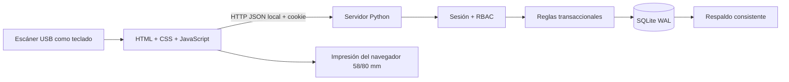
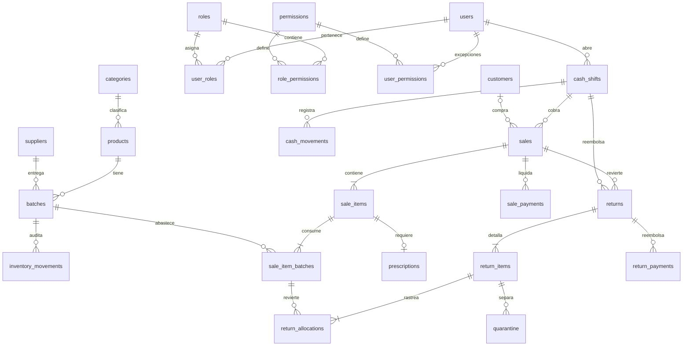

# Arquitectura y flujo de datos

## 1. Despliegue y recursos



Un proceso Python y el navegador existente evitan empaquetar otro navegador. El frontend no descarga fuentes, librerías, imágenes ni dependencias remotas. Las listas están acotadas; productos se paginan de 40 en 40, búsquedas tienen una espera de 160 ms y las respuestas antiguas no reemplazan búsquedas recientes. Las conexiones SQLite son breves y propias de cada operación.

El índice único de código de barras permite búsquedas exactas; los nombres y sustancias tienen índices para futuras búsquedas por prefijo. El fallback `LIKE '%texto%'` actual **no aprovecha esos índices para subcadenas**; tampoco está optimizado para un catálogo masivo. La consulta agrega existencias por producto, de modo que debe medirse con datos representativos. Para catálogos grandes, separar la consulta exacta de la híbrida, añadir FTS5, paginación por cursor y una proyección de stock transaccional; no introducir un caché que autorice ventas con existencias obsoletas.

Objetivos de aceptación propuestos, aún sin medición en hardware objetivo: búsqueda p95 menor de 150 ms y confirmación local p95 menor de 300 ms, salvo contención o almacenamiento lento. Validar con el catálogo real y dos cajas operando. La derivación de contraseñas es deliberadamente más costosa que una consulta de venta.

## 2. Modelo relacional



El DDL autoritativo está en `schema.sql`. Las tablas auxiliares `sessions`, `login_attempts` y `audit_log` mantienen seguridad y registro de acciones.

| Grupo | Decisión |
|---|---|
| Catálogo | Un registro por presentación vendible, código de barras único y baja lógica |
| Existencias | `batches.quantity` es la existencia vendible física del lote; stock agregado no se almacena en productos |
| Recepción | Cada entrada genera un lote/segmento con costo, proveedor y fecha de recepción propios; un mismo número de lote puede tener varias recepciones |
| Kardex | Todo cambio de cantidad produce un movimiento firmado en la misma transacción |
| Histórico | Nombre, precio, departamento e impuestos se copian a la partida; costo de lote se copia a la asignación |
| Dinero | Centavos enteros; tasas y descuentos en puntos base: 1600 = 16%, 500 = 5% |
| Unidades | Enteros positivos; una presentación por unidad. No se permite inventario fraccionario |
| Inmutabilidad | Kardex y auditoría rechazan UPDATE/DELETE; un corte cerrado rechaza UPDATE |

Estas restricciones protegen frente a errores de la aplicación. No hacen inviolable la base frente a alguien con acceso de escritura al archivo o capacidad de cambiar el esquema. No existe una interfaz de borrado físico de ventas o usuarios.

## 3. Venta y concurrencia

1. Autenticar sesión; verificar `sell` y turno abierto dentro de la transacción.
2. Ejecutar `BEGIN IMMEDIATE`: SQLite serializa a los escritores. WAL permite que los lectores continúen viendo un estado confirmado.
3. Buscar `request_key`. Si ya existe y corresponde al mismo usuario y contenido, devolver el ticket previo; si el contenido cambió, rechazar con 409.
4. Consultar precio, impuesto, descuento del cliente y flag de receta desde la base. El cliente nunca decide el total.
5. Ordenar primero los lotes con fecha por `expires_on`, `received_at`, `id`, y al final los de fecha nula por recepción; excluir caducados y existencias cero. Esto es **FEFO**; FIFO puro priorizaría recepción sin considerar caducidad.
6. Calcular descuento por partida, total y componente de impuesto con redondeo entero. Exigir que la suma de pagos aplicados coincida exactamente.
7. Guardar venta, partidas, asignaciones de lote y pagos. Descontar stock con `UPDATE ... WHERE quantity >= ?`; exigir una fila modificada. Guardar kardex y auditoría.
8. Confirmar todo mediante COMMIT; cualquier fallo revierte todos los cambios.

La segunda venta concurrente espera al escritor anterior y valida el stock ya actualizado. No hay lectura de stock fuera de la transacción utilizada para autorizar el descuento. Un cierre de turno también toma ese bloqueo, evitando que una venta se cuele después de su corte.

Los precios incluyen IVA: `impuesto = redondear(total × tasa / (10000 + tasa))`. Se redondea una vez por partida después de aplicar el descuento; la suma de impuestos de partidas se guarda en la venta. El costo se interpreta sin IVA recuperable para estimar el margen unitario: venta sin IVA menos costo. Es un indicador comercial de catálogo, no un estado contable de resultados.

El frontend conserva la clave de una venta mientras se reintenta el mismo cobro. Si se recarga la página o se pierde el estado del navegador tras una respuesta incierta, debe consultarse el ticket antes de cobrar otra vez. La persistencia de un registro de solicitudes pendientes en el cliente es una mejora de despliegue; no se afirma entrega exactamente una vez ante todos los fallos posibles.

## 4. Caja, corte X y corte Z

```text
Efectivo esperado = fondo inicial
                  + pagos aplicados en efectivo
                  - devoluciones pagadas en efectivo
                  + entradas extraordinarias
                  - salidas y pagos a proveedores

Diferencia = efectivo contado - efectivo esperado
```

Una venta de $100 cobrada con $200 en billete registra $100 aplicados y $200 recibidos: el cambio de $100 no aumenta el saldo. Tarjeta y transferencia se muestran en el reporte y cuentan como ventas, pero no se suman a la gaveta.

El corte X es una consulta de un turno abierto con `reports.view`; no cierra ni modifica contadores. Para arqueo ciego, un cajero sin ese permiso recibe 403 si intenta consultar el resumen de un turno abierto. Su endpoint de sesión devuelve solo ID, caja y apertura, sin saldo esperado.

El corte Z acepta ID de turno y un conteo físico. Bajo `BEGIN IMMEDIATE` calcula el reporte, guarda conteo/esperado/reporte congelado y marca cierre. Solo responde con el resultado después de confirmar. La misma declaración puede reintentarse; un conteo distinto sobre un turno cerrado es rechazado. No se permite editar el arqueo ya confirmado. El cajero puede consultar su propio corte cerrado.

Un administrador con permiso de reportes puede ver un corte X antes de cerrar; el arqueo ciego requiere una separación real de funciones. El sistema no pretende impedir que una persona con acceso legítimo a todos los tickets reconstruya manualmente un saldo.

El reporte agrupa ventas y devoluciones por método y departamento; las salidas detallan proveedor, folio y concepto. El corte general consolida **ventas netas** por rango de turnos y conserva la comparación de efectivo de cada turno. No suma fondos iniciales ni declara que la suma de saldos de turnos sucesivos sea efectivo físico actual.

## 5. Devoluciones y anulaciones

Cada devolución se liga al ticket original y al turno **actual** que entrega el dinero, aunque la compra ocurriera otro día. El corte histórico original no cambia. Una devolución parcial comprueba el acumulado para impedir devolver más unidades de las vendidas.

Cada centavo devuelto se calcula como diferencia de importes acumulados redondeados. Así, devolver todas las unidades siempre recupera exactamente el total original, incluso con descuentos que produzcan fracciones de centavo por unidad.

Las asignaciones de devolución apuntan a los lotes consumidos por la venta. `restock` reingresa ahí y escribe kardex; `quarantine` registra una existencia no vendible separada. Un lote caducado devuelto puede reingresar físicamente, pero sigue excluido de la siguiente venta. Anular una venta genera una devolución completa con causa; no borra la venta. Una venta con devoluciones parciales debe terminar de devolverse, no anularse.

Política incluida de reembolso: utilizar los medios originales, efectivo primero y luego el orden original de los pagos, sin exceder lo cobrado por cada medio. La devolución bancaria/terminal se realiza externamente; si una farmacia necesita elegir otro reparto, conviene introducir selección autorizada y conciliación. No hay pasarela bancaria ni una transacción distribuida con ella.

## 6. Inventario, identidad y auditoría

Recepción y ajustes exigen permisos independientes. Ajustar por conteo requiere cantidad observada en sistema, nuevo conteo y motivo: si entre observación y envío cambió el stock, se rechaza el ajuste para revisión. Merma, rotura y caducidad usan este mismo registro con motivo explícito. No se acepta un movimiento sin justificación.

Los permisos de rol se unen y después se aplican excepciones individuales permitidas/denegadas. La edición por casillas escribe excepciones explícitas para el conjunto de permisos. Las sesiones se revocan al editar usuarios; se consulta nuevamente actividad y permisos en las operaciones.

Las credenciales usan PBKDF2-HMAC-SHA256 con sal aleatoria y 310000 iteraciones. El PIN no se guarda en claro; cinco fallos bloquean la cuenta durante cinco minutos. Sesiones aleatorias se almacenan como hash, expiran a las 12 horas y viajan en cookie HttpOnly/SameSite=Strict. Para HTTPS se debe añadir `Secure`.

Se comprueban Host, Origin y una cabecera de solicitud para las mutaciones; no se habilita CORS. Los textos de catálogo se escapan antes de insertarse en HTML. La consulta de productos y lotes omite costos para usuarios no autorizados. Las bases y sus respaldos contienen datos personales: en producción, su acceso debe limitarse a la cuenta operadora, con cifrado de disco y retención definida.

## 7. Diseño de pantallas

```text
ESCRITORIO / MOSTRADOR
┌──────────────────────────────────────────────────────────────────────┐
│ Botica           Mostrador · Caja y corte · Administración    Cajero │
├──────────────────────────────────────────────────────────────────────┤
│ Mostrador                                       Turno / Caja         │
├───────────────────────────────────┬──────────────────────────────────┤
│ Buscar / escanear · F1             │ Venta actual · Vaciar            │
│ Código, nombre o sustancia         │ Cliente / descuento              │
│                                   │ Productos + cantidad + quitar    │
│ Tarjetas de productos             │                                  │
│ Precio + existencia + reorden      │ Descuento                        │
│                                   │ Total                            │
│ Ver más                           │ Cobrar · F5                      │
└───────────────────────────────────┴──────────────────────────────────┘

CAJA Y CORTE
┌───────────────────────────────────┬──────────────────────────────────┐
│ Apertura + fondo inicial          │ Resumen                          │
│ Entrada / salida / proveedor      │ Fondo, ventas por medio          │
│                                   │ Devoluciones, entradas, salidas   │
│ Arqueo ciego                      │ Esperado / contado / diferencia  │
│ [Efectivo contado]                │ Departamentos y proveedores      │
│ [Declarar y cerrar]               │ Disponible tras confirmar Z      │
└───────────────────────────────────┴──────────────────────────────────┘
```

Por debajo de 900 px las columnas se apilan; por debajo de 480 px los productos ocupan una columna. La interfaz utiliza tipografía del sistema, colores sobrios, controles con foco visible y ninguna animación. El escáner se configura como teclado con Enter al final. F1 enfoca búsqueda, F5 abre cobro y Esc cierra un formulario o limpia el carrito cuando está en Mostrador.

Los tickets usan áreas imprimibles de 50 mm y 72 mm para rollos de 58/80 mm. Seleccionar el tamaño correcto en el controlador y desactivar encabezados/pies del navegador; verificar el margen real de la impresora. El código conserva posibilidad de reimpresión, pero no verifica que el papel haya salido físicamente.

## 8. Evolución para operación de varias cajas

Mantener API y dominio separados permite sustituir SQLite por PostgreSQL cuando se necesite concurrencia de escritura sostenida o múltiples estaciones. En esa implementación, bloquear filas de lotes con un orden estable y filas de turno, conservar claves de idempotencia y restricciones de stock, y añadir migraciones versionadas. Las reglas no deben trasladarse al navegador.

Antes de una puesta en operación: validar políticas de devolución/receta y requisitos locales; verificar impresora/escáner; establecer administración de cuentas y restauración; medir rendimiento; elegir servidor de producción si se sale de localhost; añadir conciliación bancaria y fiscal donde corresponda. Estas integraciones no se simulan como si ya estuvieran implementadas.


## 9. Importación, recuperación y versión de esquema 2

Las fechas de lote aceptan NULL. La migración de bases antiguas reconstruye batches conservando IDs, verifica relaciones y crea primero una copia consistente de seguridad. El esquema usa user_version=2. Un lote de fecha desconocida sigue siendo vendible, sin alertas de caducidad hasta completarla.

Las importaciones tienen previsualización, selección por existencia, exclusiones, validación de datos e idempotencia en inventory_imports. La confirmación compara una revisión del catálogo y lotes con la vista previa para rechazar cambios concurrentes. Sustituir cantidades exige turnos cerrados, compensa lotes previos con kardex y crea nuevas recepciones, todo en una transacción. El modo omitir no vuelve a sumar existencias. Al actualizar desde tablas antiguas se conservan sustancia, flag de receta, baja lógica, punto de reorden y máximo existentes, porque el origen carece de esos campos.

La exportación JSON de inventario conserva metadatos y lotes; la tabla CSV/XLS agrega stock físico y pierde los detalles que no representan sus ocho columnas. El respaldo completo JSON incluye todas las tablas comerciales y de identidad en una lectura consistente, excepto sesiones e intentos de login. Su huella detecta corrupción accidental; no cifra ni autentica criptográficamente al autor.

La restauración admite exclusivamente una base sin datos comerciales. Solo inserta datos en tablas/columnas del esquema conocido, nunca ejecuta SQL del archivo. Reemplaza filas dentro de BEGIN IMMEDIATE, difiere claves foráneas, comprueba integridad y restablece triggers. Ante un fallo hace rollback. La capa HTTP serializa autenticación y solicitudes por instancia durante este proceso para que ningún usuario conserve una identidad anterior; las sesiones se invalidan. Las cookies llevan el puerto en el nombre para separar instalaciones locales en puertos distintos.
